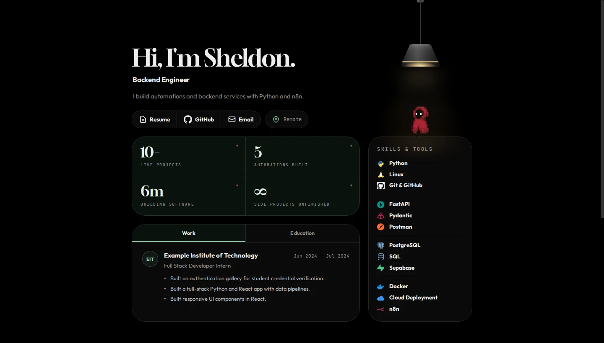
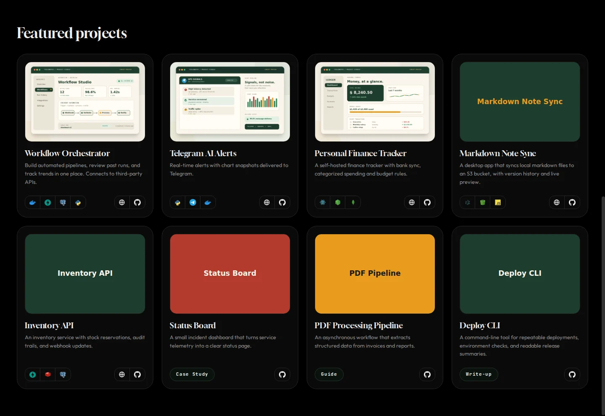
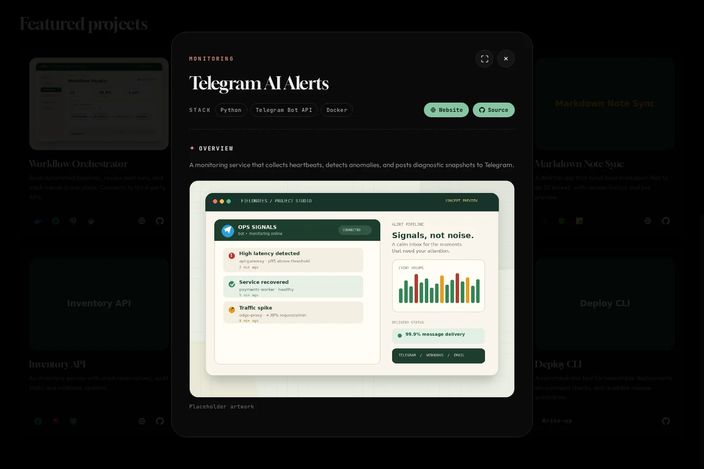

# Portfolio

 

A responsive developer portfolio built with plain HTML, CSS and JavaScript. Your content lives in folders and JSON
files, and a small Python script turns it into a static site you can host anywhere.



## Features

- One folder per project or post. Adding one needs no HTML editing
- Dark theme by default, with a light theme behind a hanging-lamp toggle
- Project dialogs with expand and restore, usable by keyboard
- Responsive from phones to wide desktops
- Minified, fingerprinted CSS and JavaScript, no runtime dependencies
- No-index by default, switchable per deployment

## Screenshots

| Projects | Project dialog |
|---|---|
|  |  |


## Quick start

Requires Python 3.8 or newer. Nothing else to install.

```bash
python scripts/build.py --serve     # build into _site/ and serve http://localhost:8000
python -m unittest discover -s tests
```

Use `python3` where `python` is not available.

## Add a project

Create a folder in `content/projects/`:

```text
content/projects/weather-cli/
├── project.json
├── README.md        optional, shown in the dialog
└── cover.webp
```

```json
{
  "title": "Weather CLI",
  "kicker": "Command Line",
  "summary": "Prints a clean forecast in your terminal.",
  "stack": ["Python", "Docker"],
  "source": "https://github.com/your-username/weather-cli"
}
```

Posts (case studies, guides, write-ups) work the same way in `content/posts/`. See the
[content guide](docs/CONTENT.md) for every field.

## Project structure

```text
content/        Your content: site.json, profile/, projects/, posts/
src/            Templates, ordered CSS and JavaScript modules, static assets
scripts/        The build tool (standard library only)
tests/          Unit tests
docs/           Guides
.github/        CI and GitHub Pages workflows
```

## Deployment

Push to `main` and enable **Settings > Pages > Source > GitHub Actions**. For Cloudflare Pages, use the build command
`python3 scripts/build.py` and the output directory `_site`. Details, environment variables and search-indexing
options are in [docs/DEPLOYMENT.md](docs/DEPLOYMENT.md).

## Documentation

- [Content guide](docs/CONTENT.md)
- [Deployment](docs/DEPLOYMENT.md)
- [Architecture](docs/ARCHITECTURE.md)
- [Contributing](CONTRIBUTING.md) and [Security](SECURITY.md)

## License

[MIT](LICENSE)
